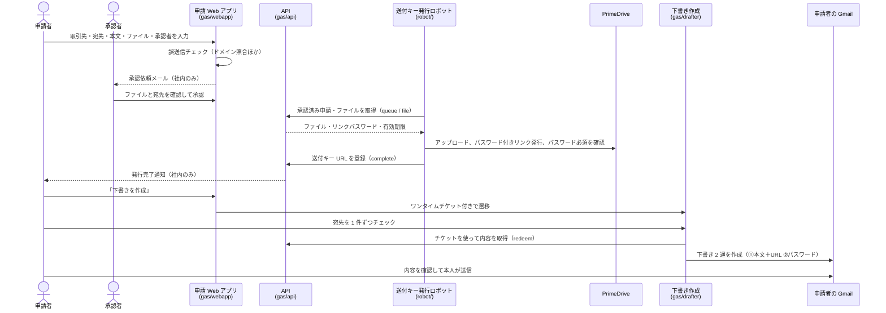

# PrimeDrive 外部ファイル送付ワークフロー

社外へのファイル送付を **メール添付せず PrimeDrive の送付キー（ダウンロードリンク）で行う** ための仕組みです。

- 送付キーの発行には **上長などの承認が必須**
- 承認後、送付キー発行ロボット（Node.js + Playwright）が PrimeDrive へアップロードし、**リンクパスワード付き**で送付キー（ダウンロードリンク）を発行
- 送付キー URL を差し込んだメールと、パスワードのメールを **申請者本人の Gmail に下書きとして作成**
- **メールは自動送信しません**。最終確認と送信は申請者本人が行います

## 全体の流れ



## 申請の状態

`承認待ち` → `承認済み(発行待ち)` → `送付キー発行中` → `送付キー発行済み` → `下書き作成済み`

途中で `差戻し`・`取下げ`・`発行エラー`（申請者が再実行可）に分岐します。

## 誤送信防止の仕組み

| タイミング | 対策 |
|---|---|
| 申請時 | 宛先ドメインが **取引先マスタの登録ドメインと一致しない場合は申請不可** |
| 申請時 | 入力ミスと思われるドメイン（例：`abc-shoj.co.jp`）に正しい候補を提示 |
| 申請時 | 別の取引先のドメインが混ざっている場合はその取引先名を表示してエラー |
| 申請時 | To の **再入力（貼り付け禁止）** による照合 |
| 申請時 | フリーメール、To への社内アドレス、To/Cc 重複を警告 |
| 申請時 | ファイル名・件名・本文に **別の取引先名** が含まれていれば警告（取り違え防止） |
| 申請時 | 本文へのパスワード記載・実行形式ファイル・自己承認を禁止 |
| 承認時 | 承認者が実ファイルを開き、宛先・ファイル・目的の 3 項目をチェックしないと承認できない |
| 発行時 | 送付キーは承認済み申請に対してのみ、ロボットが発行（一般ユーザーは PrimeDrive で直接発行不可にする） |
| 発行時 | 発行後にパスワード必須・ファイル一致を自動確認。異常時はフォルダごと削除してリンクを無効化 |
| 下書き時 | 下書きの宛先は **承認された宛先から自動設定**（手入力しない） |
| 下書き時 | 宛先を 1 件ずつチェックしないと下書きを作成できない |
| 下書き時 | パスワードは別の下書きに分離。本文メールには含めない |
| 送信後 | 誤送信に気づいたら PrimeDrive で送付キーを無効化すれば、ファイルは取得されない |

## セキュリティ上の考慮

- 申請データは専用のスプレッドシートに保存し、システム用アカウントのみがアクセスできます。
- リンクパスワードは下書き作成と同時にシートから消去します。
- 下書き作成画面へはワンタイムチケット（15 分有効・1 回限り・ハッシュのみ保存）で遷移し、申請者本人以外は開けません。
- ロボット用 API は共有トークンで認可し、送付キー URL の形式を検証します。
- ロボットは発行したリンクを未ログインのブラウザで開き、パスワードが必須であることを毎回確認します。
- 通知メールは社内ドメイン宛てのみに制限しています。
- すべての操作を「監査ログ」シートに記録します。

## 構成

```
gas/webapp/   申請・承認 Web アプリ（実行：システム用アカウント／アクセス：ドメイン内）
gas/api/      ロボット・下書き作成アプリ用 API（実行：システム用アカウント／アクセス：匿名＋トークン）
gas/drafter/  Gmail 下書き作成アプリ（実行：アクセスしたユーザー／アクセス：ドメイン内）
robot/        送付キー発行ロボット（Windows PC でタスクスケジューラから定期実行）
docs/         セットアップ手順
test/         入力チェック・本文生成・全体フローのテスト（Google サービスはモック）
```

3 つの Apps Script プロジェクトに分けているのは、**実行ユーザーとアクセス範囲がそれぞれ異なる** ためです
（データはシステム用アカウントで保護しつつ、下書きは申請者本人の Gmail に作成する必要があるため）。

## テスト

```bash
npm test
```

セットアップ手順は [docs/セットアップ手順.md](docs/セットアップ手順.md)、ロボットの導入は [robot/README.md](robot/README.md) を参照してください。
