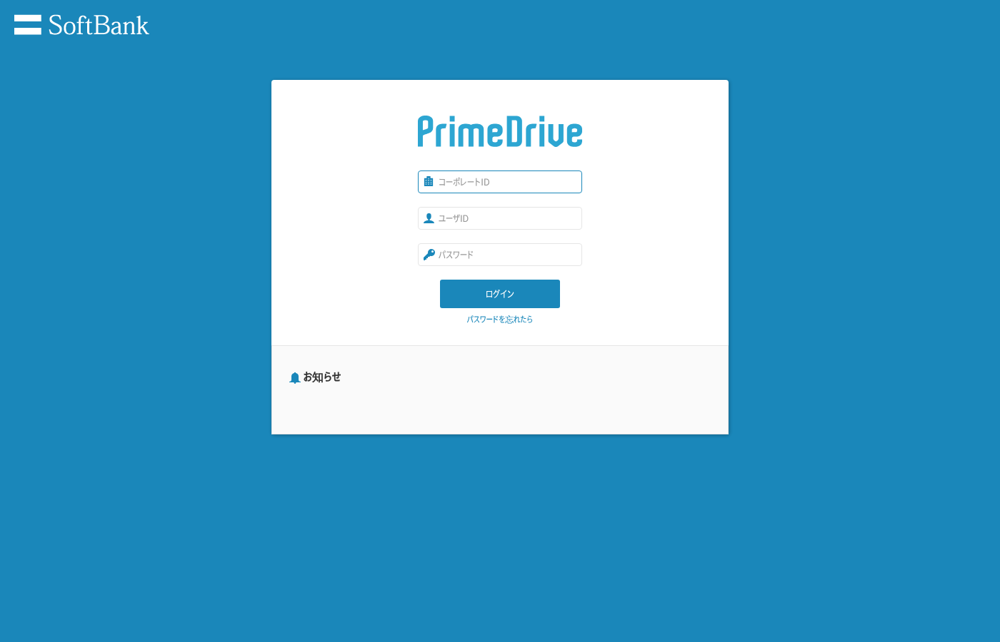
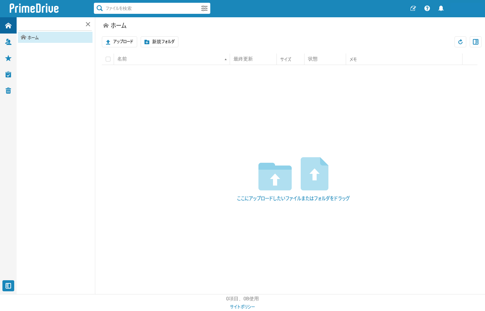
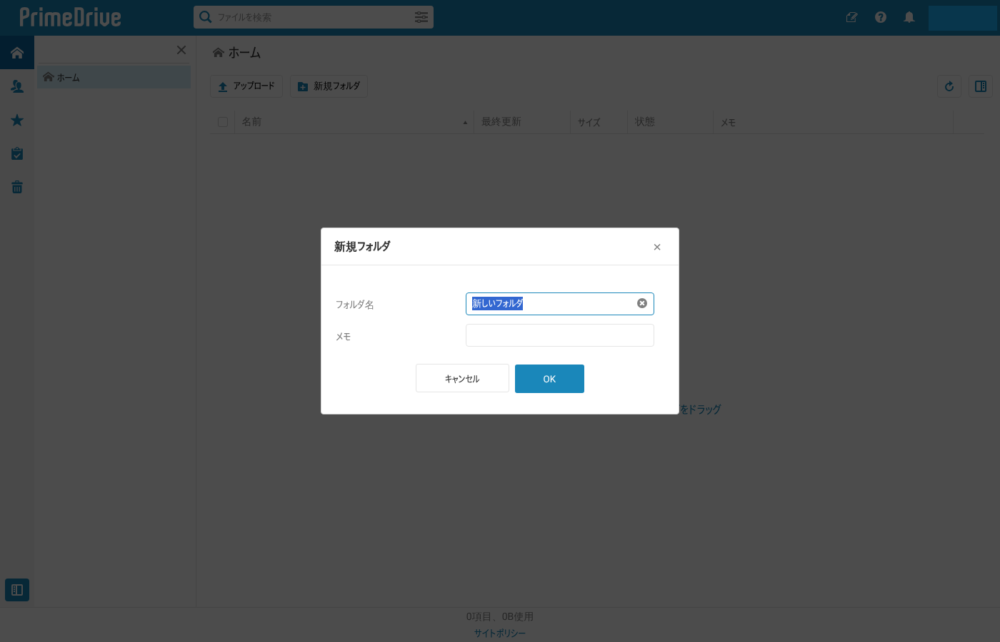
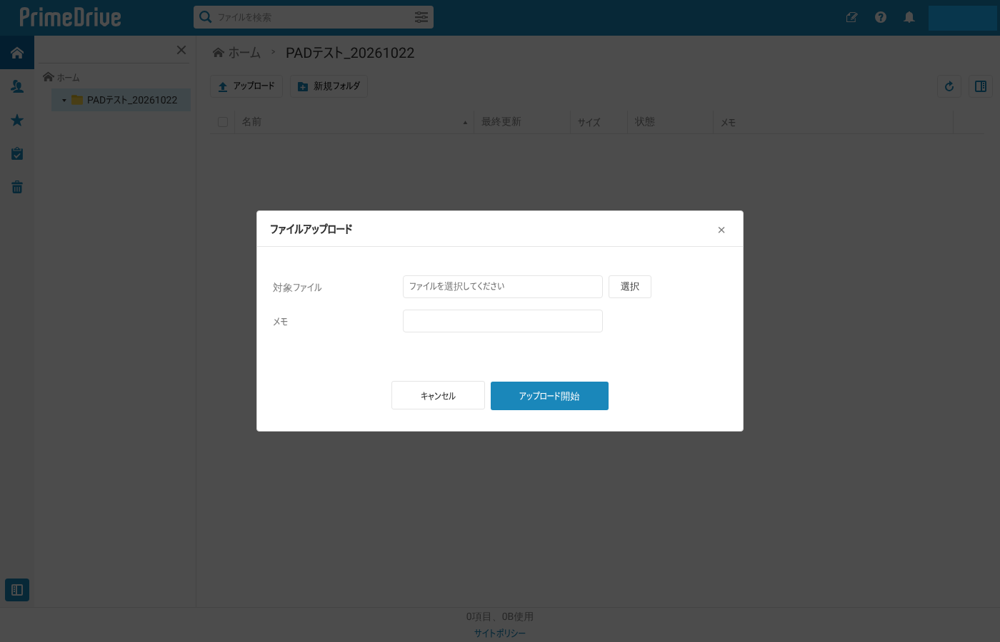
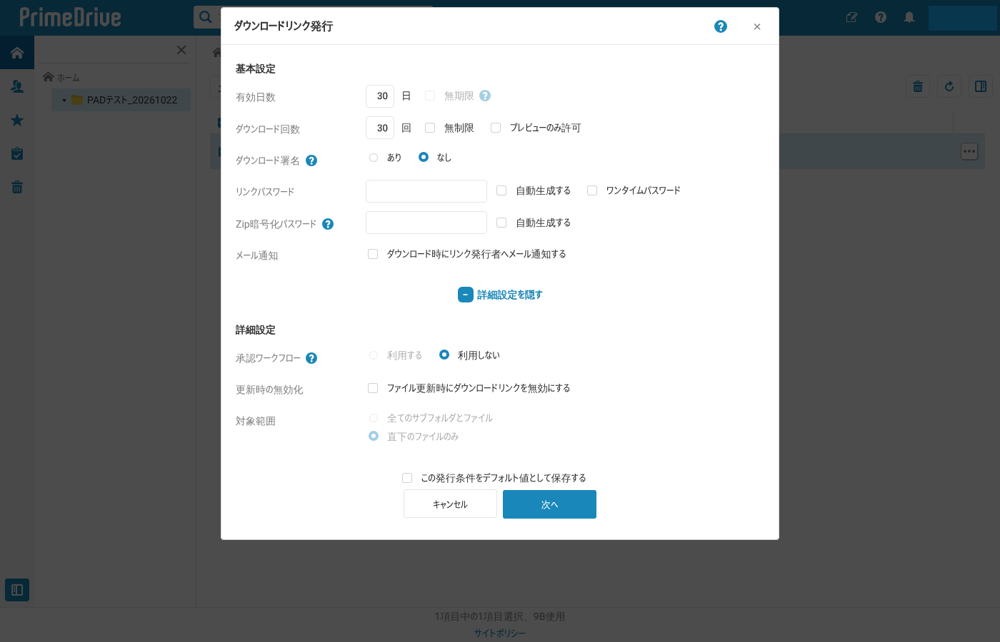
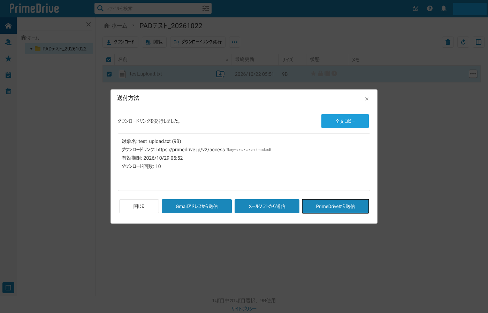
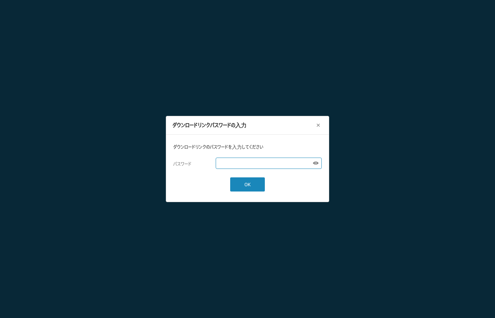
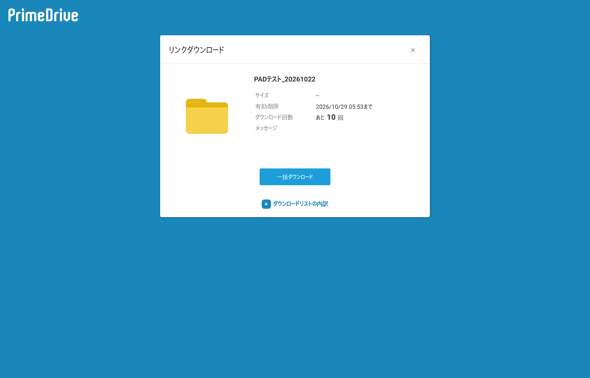
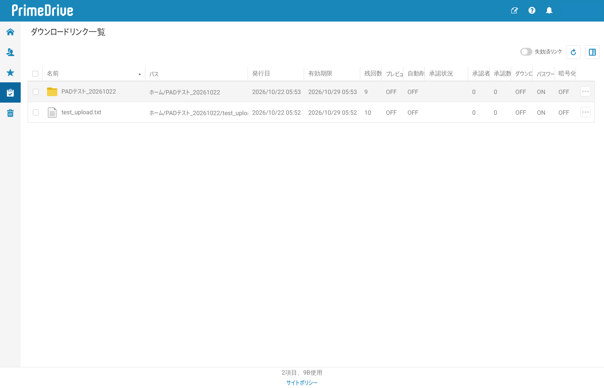

# PrimeDrive 画面調査（PAD フロー用）

2026-10-22 に検証用アカウントで `https://primedrive.jp/v2/browse`（Web 版 v43.0.7）を Chromium + Playwright で実際に操作して調べた結果です。
`pad/flow.robin.txt` の JavaScript は、ここに書いたセレクターだけを使っています。

- 画面は React 製の 1 ページアプリです。URL はログイン後も `/v2/browse#<コーポレートID>` のまま変わりません。
- 入力欄は、値を代入するだけでは React に伝わりません。ネイティブの `value` セッターで代入してから `input`・`change` イベントを発火させます（フローの `setVal` 関数）。
- ボタンは JavaScript の `element.click()` で押せます。例外は次の 2 つです。
  - **ユーザーメニュー**：マウスを乗せると開くので、`mouseover` イベントを発火させます。
  - **ファイル選択**：ブラウザの制限で、スクリプトからはファイル選択ダイアログを開けません。`input[type=file]` にフォーカスしてから、実際のキーで Enter を押すと開きます。
- 一覧の行は `tr.ListViewItem` で、`data-identifier` 属性にホームからのパス（`/HOME/フォルダ/ファイル名`）が入っています。行の特定にはこの属性を使います。
- ダイアログは `.PopupWindow` に画面ごとのクラスが付いた要素です（例：`.NewFolderDialog`）。エラーダイアログはタイトル（`.DialogTitle`）が「エラー」になります。
- 通信先は `primedrive.jp` と Google Fonts だけです。CSP ヘッダーは付いていないので、PAD の JavaScript 実行も妨げられません。

スクリーンショットはユーザー名と送付キーを塗りつぶしています。

---

## 1. ログイン画面

`/v2/browse` を未ログインで開くと表示されます。



| 項目 | セレクター |
|---|---|
| コーポレートID | `input[name="corpId"]` |
| ユーザID | `input[name="userId"]` |
| パスワード | `input[name="password"]` |
| ログインボタン | `button.LoginButton` |

ログインが終わると、`button.CommandNewFolder` が現れます。フローはこのボタンでログイン完了を判定しています。

## 2. ホーム（ファイル一覧）



| 項目 | セレクター | 備考 |
|---|---|---|
| 左端タブ：ホーム | `button.TabHome` | |
| 左端タブ：お気に入り / ごみ箱 | `button.TabFav` / `button.TabTrash` | |
| 左端タブ：各種一覧 | `button.TabSpecials` | マウスを乗せると「ダウンロードリンク一覧」などのメニューが出る |
| パンくず | `button.DirectoryButton` | 先頭が「ホーム」。最後のボタンが現在のフォルダ |
| アップロード | `button.CommandUpload` | |
| 新規フォルダ | `button.CommandNewFolder` | |
| 更新 | `button.RefreshButton` | |
| 一覧の行 | `tr.ListViewItem[data-identifier="/HOME/…"]` | フォルダを開くには、行の `td[data-testid=titleDom]` に `dblclick` を発火させる |
| 行のチェックボックス | `tr.ListViewItem input.CheckBoxInput` | クリックで選択／解除 |
| ユーザーメニュー | `button.UserButton` | `mouseover` で `.PopupMenu` が開く |

行を選ぶと、ツールバーが選択中の操作に変わります。

| 選択中 | ボタン |
|---|---|
| ファイル | `button.CommandDownload`（ダウンロード）、`button.CommandView`（閲覧）、`button.CommandSend`（ダウンロードリンク発行）、`button.TrashButton`（削除） |
| フォルダ | `button.CommandDownload`、`button.CommandShare`（共有）、`button.CommandSend`、`button.TrashButton` |

行の右端にある `span.issue-download-link`（「ダウンロードリンクを保存条件で発行」）は、保存済みの条件ですぐに発行するボタンです。フローでは使いません。

## 3. 新規フォルダ



ダイアログは `.NewFolderDialog`（`.SimpleInputDialog`）です。

| 項目 | セレクター |
|---|---|
| フォルダ名 | `input[name="folderName"]`（初期値「新しいフォルダ」） |
| メモ | `input[name="memo"]` |
| OK | `.NewFolderDialog button.ProceedButton` |
| キャンセル | `button.CancelButton` |

作成すると、一覧に `/HOME/<親>/<名前>` の行が増えます。

## 4. ファイルアップロード



ダイアログは `.FileUploadDialog` です。

| 項目 | セレクター | 備考 |
|---|---|---|
| 対象ファイル（表示欄） | `input.FileNameInput` | 選ぶとファイル名（パスなし）が入る |
| 選択ボタン | `button.SelectButton` | 上に透明な `input[type=file]` が重なっていて、クリックはそちらが受け取る |
| ファイル入力 | `.FileUploadDialog input[type=file]` | `multiple` なし。1 つ選ぶと、2 件目用の行が下に追加される |
| メモ | `input.MemoInput` | |
| アップロード開始 | `button.UploadStartButton` | 押すと「ファイルをアップロードしています…」の進捗ダイアログが出る |

確認できたこと：

- `button.SelectButton.click()` や `input.click()` をスクリプトから実行しても、ファイル選択ダイアログは**開きません**（ユーザー操作が必要なため）。
- `input[type=file]` に `focus()` してから、実際のキーで **Enter** を押すと開きます。PAD では、JavaScript でフォーカス → ブラウザのウィンドウに `{Enter}` を送る → Windows の「開く」ダイアログにパスを貼り付けて `{Enter}`、の順に操作します。
- 日本語のファイル名（`テスト資料.txt`）もアップロードでき、ダウンロードした ZIP の中でも正しいファイル名になっていました。
- アップロードが終わるとダイアログが閉じ、一覧に行が追加されます。同じ名前のファイルがある場合の上書き確認は、事前チェック API（`pretestUploadFile`）が判定します。フローは毎回新しいフォルダを作るので、上書き確認は出ません。

## 5. ダウンロードリンク発行（送付キー）

フォルダかファイルを 1 つ選び、`button.CommandSend`（ダウンロードリンク発行）を押します。フローでは、申請 ID のフォルダに対して発行します。こうすると、ファイルが複数あっても URL は 1 つです。



ダイアログは `.AccessKeyIssueDialog` です。下の表の「既定値」は検証用アカウントでの値です。

| 項目 | セレクター | 既定値 | フローでの設定 |
|---|---|---|---|
| 有効日数 | `input[name="availableDays_input"]` | 30 | `job.expiryDays` |
| 無期限 | `input[name="availableDays_checkbox"]` | OFF（**管理設定で無効化**） | OFF |
| ダウンロード回数 | `input[name="downloadCount_input"]` | 30 | `MaxDownloads`（既定 10） |
| 無制限 | `input[name="downloadCount_checkbox"]` | OFF | OFF |
| プレビューのみ許可 | ラベル「プレビューのみ許可」のチェックボックス | OFF | OFF |
| ダウンロード署名 | `input[name="requiredSignature"]`（あり／なし） | なし | 変更しない |
| リンクパスワード | `input[name="downloadPassword_input"]`（type=password） | 空 | `job.password` |
| 自動生成する | `input[name="downloadPassword_checkbox"]` | OFF | OFF |
| ワンタイムパスワード | ラベル「ワンタイムパスワード」のチェックボックス | OFF | OFF |
| Zip暗号化パスワード | `input[name="zipEncryptPassword_input"]` / `_checkbox` | 空 / OFF | 変更しない |
| メール通知（発行者へ） | ラベル「ダウンロード時にリンク発行者へメール通知する」 | OFF | OFF |
| ＋さらに詳細を設定する | `.DetailPartTitle` | 閉 | 開かない |
| 承認ワークフロー | `input[name="enabledWorkflow"]` | 利用しない（「利用する」は無効） | 変更しない |
| 更新時の無効化 | ラベル「ファイル更新時にダウンロードリンクを無効にする」 | OFF | 変更しない |
| 対象範囲 | `input[name="immediate"]` | 直下のファイルのみ（変更不可） | 変更しない |
| ファイルの自動削除 | ラベル「リンク失効時に対象ファイルを自動削除する」 | OFF（無効） | 変更しない |
| ファイル受領者へのメッセージ | `textarea[name="message"]` | 空 | 変更しない |
| この発行条件をデフォルト値として保存する | ラベル同名のチェックボックス | OFF | OFF |
| 次へ | `.AccessKeyIssueDialog button.ProceedButton` | | |

- 入力エラーがある欄には `.validity-invalid` が付きます。フローは「次へ」を押す前と後にこのクラスを確認します。
- **「次へ」を押した時点で発行されます**（確認画面はありません）。
- 記号を含むパスワード（`#$%&+-=?@` をすべて含む 12 文字）で発行し、そのパスワードでダウンロードできることを確認しました。

## 6. 発行結果（送付方法）



ダイアログは `.MailerSelectDialog` です。

| 項目 | セレクター |
|---|---|
| 発行結果の本文 | `.MailerSelectDialog .ResultDetail` |
| 全文コピー | `button.DetailCopyButton` |
| 閉じる | `button.CloseTextButton` |
| Gmailアドレスから送信 / メールソフトから送信 / PrimeDriveから送信 | `button.SendByGmailButton` / `button.SendByLocalMailerButton` / `button.SendByWebMailButton`（**使わない**） |

`.ResultDetail` の本文は次の形式です。フローはここから URL と有効期限を取り出します（クリップボードは使いません）。

```
対象名: <フォルダ名>
ダウンロードリンク: https://primedrive.jp/v2/access?key=<22文字のキー>
有効期限: 2026/10/29 06:03
ダウンロード回数: 5
```

**送付キー URL の先頭は `https://primedrive.jp/v2/access?key=`** です。

## 7. 受信者側（送付キー URL を開いたとき）

| 画面 | 内容 |
|---|---|
| パスワード入力 | 「ダウンロードリンクパスワードの入力」。`input[name="password"]` と OK ボタン |
| リンクダウンロード | 対象名・有効期限・残り回数と「一括ダウンロード」。フォルダは ZIP にまとめてダウンロードされる |
| 無効化済み | 「E303: ダウンロードリンクが無効になっています。」 |




- ダウンロード回数は、実際にダウンロードしたときだけ減ります。パスワードを入れて画面を開いただけでは減りませんでした。
- ダウンロードした ZIP の中身（`テスト資料.txt`・`b.txt`、どちらも中身「テスト」）が元のファイルと一致することを確認しました。

## 8. ダウンロードリンク一覧（無効化）

`button.TabSpecials` にマウスを乗せ、メニューの「ダウンロードリンク一覧」を選びます。



| 項目 | セレクター |
|---|---|
| 行 | `tr.ListViewItem[data-identifier="/SPECIALS/ACCESS_KEYS/<キー>"]` |
| URL表示 / アクセス履歴 | `button.CommandShowKeyURL` / `button.CommandAccessHistory` |
| 無効にする | `button.CommandRevokeKey` → 確認ダイアログ `.AccessKeyRevokeConfirmDialog` の `button.ProceedButton`（OK） |
| 失効済リンクの表示切替 | `button.RevokedToggleButton` |

列：名前・パス・発行日・有効期限・残回数・プレビューのみ・自動削除・承認状況・承認者数・承認数・ダウンロード署名・パスワード・暗号化。

## 9. 削除・ごみ箱

| 操作 | セレクター |
|---|---|
| 削除（ごみ箱へ移動） | 行を選んで `button.TrashButton` → `.DeletionConfirmDialog button.ProceedButton`（「ごみ箱に移動」） |
| ごみ箱 | `button.TabTrash`。行は `/TRASH/<番号>` |
| 完全削除 | `button.CommandPermanentlyDelete` → `.PermanentlyDeletionWizardConfirmDialog button.ProceedButton`（「完全に削除」） |
| 元に戻す / 空にする | `button.CommandRestoreFromTrash` / `button.CommandEmptyTrash` |

送付キーの対象を削除・移動・名前変更すると、そのリンクは無効になります（E303）。フローは発行後のファイルを削除しません。

## 10. ログアウト

`button.UserButton` に `mouseover` → `.PopupMenu .MenuItem`（「ログアウト」）を `click()` します。確認ダイアログは出ず、`/v2/logout` の「ログアウトしました。」の画面に移ります。

ユーザーメニューの項目：会社名（クリック不可）・ユーザ設定・アドレス帳・プライベートグループ・パスワード変更・ユーザログ参照・ログアウト。

## 調査時の後片付け

調査で作ったものはすべて片付けました：テスト送付キー 3 件を無効化 → テストフォルダをごみ箱経由で完全削除 → ログアウト。
送付キーは、無効化したあとも「失効済リンク」の履歴に残ります（PrimeDrive の仕様で、削除できません）。
